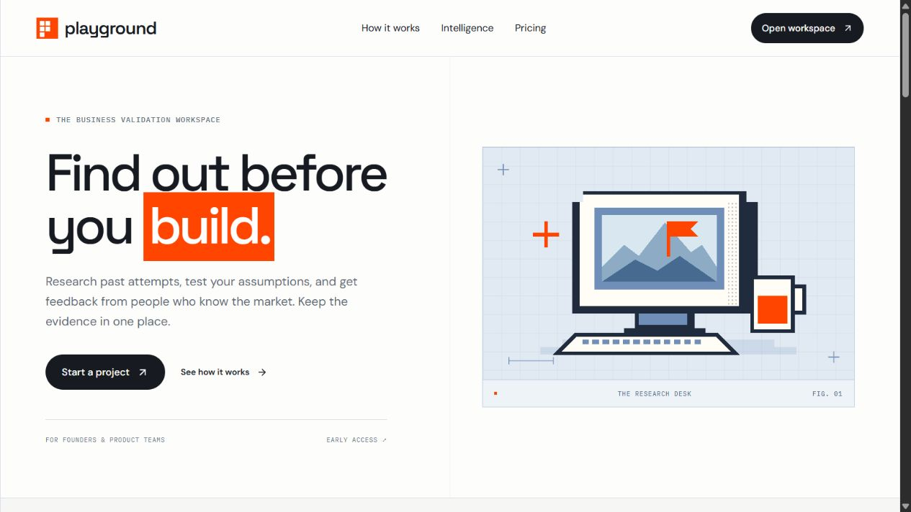

# Playground

A workspace for researching a business idea, planning experiments, collecting expert feedback and recording a decision.

**This repository is the Vercel version.** It uses Next.js, Better Auth and Turso/libSQL. It includes the frontend, backend, database schema, account system, original illustrations, OpenAI research integration and Stripe Checkout integration.

[](https://vercel.com/new/clone?repository-url=https%3A%2F%2Fgithub.com%2FPRABHMANNAT%2FPlayground-Product-ui&env=TURSO_DATABASE_URL,TURSO_AUTH_TOKEN,BETTER_AUTH_SECRET&envDescription=Add%20your%20Turso%20database%20URL%2C%20database%20token%20and%20a%20random%20authentication%20secret%20of%20at%20least%2032%20characters.&envLink=https%3A%2F%2Fgithub.com%2FPRABHMANNAT%2FPlayground-Product-ui%23deploy-on-vercel&project-name=playground-product&repository-name=playground-product)



## Use the platform

After the owner deploys the project, Vercel displays a website link, usually ending in `.vercel.app`. Open that link in your browser. Customers do not need GitHub, Vercel or any API keys. The workspace and company archive are visible to everyone without signing in.

1. Click **Open workspace** to browse freely. When you want to save work, click **Sign in**, then **Create an account**. Enter your name, email and a password of at least 12 characters. If the site sends a verification email, open that email first.
2. Click **New project**. Describe your idea, who it is for and what you want to learn.
3. Open **Startup Graveyard** to read the historical cases. Follow a source and click **Save to a project** to keep a relevant finding.
4. Open your project’s **Evidence** tab. Add a fact with a source, a hypothesis or an unanswered question. **Web research** is available when the owner connects OpenAI; review the sources it returns.
5. Open **Experiments**. Create a starter plan or a custom test. Run the test with actual participants, then record the observations and outcome.
6. Use **Human network** to request a specialist or customer review. The operator will review the request and agree on the scope and availability.
7. Open your project’s **Decision report**. Record whether to pursue, change or pause the idea, and explain why. Download Markdown or choose **Print / Save PDF**.
8. Use **Packages & billing** to request a paid pilot. Checkout appears after the operator scopes the request and payments are enabled. A request alone does not charge you.

Public browsing shows an empty workspace and the curated archive. Creating projects, saving evidence, sending requests and exporting account records require sign-in. Existing customer records are never published in guest mode.

Your work is saved to your account. You can return later, sign in and continue. **Settings → Export workspace** downloads your records as JSON. Operators can access customer records to deliver requested services. Permission to reuse anonymized findings starts off.

## Deploy on Vercel

### 1. Create the database

Create a **libSQL database** in [Turso](https://turso.tech/). Copy its database URL and an authentication token. Use a URL beginning with `libsql://`, not a local file path. Choose the libSQL-compatible offering because this app uses `@libsql/client` and Drizzle.

The app creates its initial tables automatically on first use. You do not need to paste SQL into a dashboard. Existing records are preserved.

### 2. Import the repository

Click the **Deploy with Vercel** button above, or open [Vercel New Project](https://vercel.com/new) and import `PRABHMANNAT/Playground-Product-ui`.

Use these settings:

| Setting | Value |
| --- | --- |
| Framework | Next.js |
| Root directory | Repository root; leave blank/default |
| Install command | `npm ci` |
| Build command | `npm run build` |
| Output directory | Default; do not override |
| Node.js | 24.x |
| Production branch | `main` |

Add these environment variables in Vercel:

| Variable | What to enter |
| --- | --- |
| `TURSO_DATABASE_URL` | Your remote database URL |
| `TURSO_AUTH_TOKEN` | Your database token; keep it secret |
| `BETTER_AUTH_SECRET` | A random secret of at least 32 characters; keep the same value across redeployments |
| `ADMIN_EMAILS` | The operator’s sign-in email; comma-separated if there is more than one |
| `SALES_ENABLED` | `false` until checkout is configured and tested |

To generate an authentication secret on your own computer:

```sh
node -e "console.log(require('node:crypto').randomBytes(32).toString('hex'))"
```

Keep secrets in Vercel’s environment settings. Do not add them to GitHub or use a `NEXT_PUBLIC_` prefix.

Click **Deploy**. Open the website URL Vercel provides. The authentication configuration recognizes the exact Vercel deployment and production hosts. If you add a custom domain, set both `BETTER_AUTH_URL` and `SITE_URL` to its HTTPS origin, such as `https://playground.example.com`, then redeploy.

Vercel builds future pushes to `main` when Git integration is enabled. Use a separate Turso database for Preview and Production environments so preview tests do not affect customers.

### 3. Set up operator access

Create an account on the deployed website using the email in `ADMIN_EMAILS`. Ordinary registration does **not** grant operator access until the email is verified.

Choose either:

- Configure the email service below and verify the email through your inbox.
- For a private pilot, confirm that the registered account belongs to the operator. On your trusted computer, put the production Turso credentials and the same `ADMIN_EMAILS` in ignored `.env.local`, then run:

```sh
npm ci
npm run admin:verify -- your-operator-email@example.com
```

Sign in again. **Operations** lets the operator review missions, check contributor applications, manage delivery and scope orders. The maintenance command requires database credentials and is not exposed as a website endpoint.

### 4. Optional email verification and password recovery

Set `RESEND_API_KEY` and `EMAIL_FROM` in Vercel, using a sender domain verified in [Resend](https://resend.com/), then redeploy. This enables verification emails and the **Forgot password?** flow. Without these settings, ordinary accounts can sign up and sign in, but automated email verification and password recovery are unavailable. Operator access still requires verification.

## Add OpenAI later

In Vercel, add `OPENAI_API_KEY` as a server environment variable and redeploy. The OpenAI account needs billing/credits and access to the configured model’s web search and structured outputs. `OPENAI_MODEL` defaults to `gpt-4.1-mini`.

The **Web research** button then enables automatically. It asks permission before sending the project brief to OpenAI. Results are saved as hypotheses with references for human review. No code change is required. Limits are 5 research runs per account and 50 site-wide per UTC day; set a provider spending limit too.

## Add Stripe later

1. Start with Stripe test mode. Add `STRIPE_SECRET_KEY` in Vercel.
2. In Stripe, create a webhook pointing to `https://YOUR-VERCEL-DOMAIN/api/stripe/webhook`.
3. Subscribe to `checkout.session.completed` and `checkout.session.async_payment_succeeded`.
4. Copy that endpoint’s signing secret into Vercel as `STRIPE_WEBHOOK_SECRET`.
5. Set `SALES_ENABLED=true` and redeploy. Ensure Vercel Deployment Protection allows Stripe to reach the webhook on the production domain.
6. Request a package in the app. In **Operations**, set the order to **Scoping**. The customer can then open checkout from **Packages & billing**.
7. Complete a Stripe test payment. Verify that the order becomes **Paid** through the webhook before using live keys.

Prices are controlled by the server in AUD. Visiting a success URL does not mark an order paid. The optional `node scripts/configure-stripe.mjs` helper registers the webhook using ignored `.env.local`; copy the resulting secret into Vercel yourself. Never commit that file.

Confirm the actual offers, tax treatment, refund policy, business contact and delivery capacity before enabling live sales. Refunds, disputes and expert payouts are handled by the operator outside this pilot app.

## Run on your computer

Install Node.js 24. Clone the repository and open its folder:

```sh
git clone https://github.com/PRABHMANNAT/Playground-Product-ui.git
cd Playground-Product-ui
npm ci
```

Copy `.env.example` to `.env.local`. Set `BETTER_AUTH_SECRET` to a generated secret. The example uses a local database, so no Turso token is needed for local development. Keep the database URL as `file:playground.db` and the website URLs as `http://localhost:3000`.

```sh
npm run dev
```

Open [localhost:3000](http://localhost:3000). Create your own account; there are no default passwords or seeded customer records.

To check the production build:

```sh
npm run typecheck
npm test
npm run build
npm start
```

`npm run test:integration` runs real account, database and webhook checks against an isolated local production server. It requires a local `file:` test database, no OpenAI or Stripe API keys, `SALES_ENABLED=false`, and a synthetic `STRIPE_WEBHOOK_SECRET` shared by the server and test process. It creates and removes its own test records. Never point it at a customer database.

## What is included

- Responsive marketing site and workspace, with original pixel illustrations.
- Accounts, server sessions, per-account access checks and verified operator access.
- Persistent project briefs, source-linked evidence, experiments and observations.
- Human review requests, contributor applications and operator fulfillment.
- Decision reports, Markdown/PDF printing and JSON export.
- Optional OpenAI web research and Stripe checkout with signed, idempotent webhooks.
- Database schema, automatic initial setup, provider tests and integration checks.

This is a concierge pilot. Experts must be recruited and verified by the operator. Automated browser test execution, recurring competitive monitoring, automatic expert matching and payouts are not implemented. The archive begins with four curated cases. Privacy and terms pages identify the business details to complete before public paid onboarding.

## Technical notes

The Vercel version runs standard Next.js Node.js functions. It authenticates using Better Auth sessions, not Sites gateway headers. Turso keeps records outside Vercel’s temporary filesystem. SQL values are parameterized, and multi-statement writes use transactions. An email must be both allowlisted and verified for operator access.

The original Cloudflare migration history is retained under `docs/cloudflare-migrations` for reference. It is not executed by this version, and existing Sites accounts/data are not automatically transferred. The new initial schema is in `db/migrations/0000_initial.sql`; its runtime counterpart is `db/bootstrap.mjs`. Future schema changes need reviewed migrations rather than table replacement.

See [verification notes](docs/VERIFICATION.md) for test results and remaining limits. Implementation references: [Next.js](https://nextjs.org/docs), [Better Auth](https://better-auth.com/docs/integrations/next), [Turso](https://docs.turso.tech/sdk/ts/reference), [OpenAI web search](https://developers.openai.com/api/docs/guides/tools-web-search) and [Stripe webhooks](https://docs.stripe.com/webhooks).
